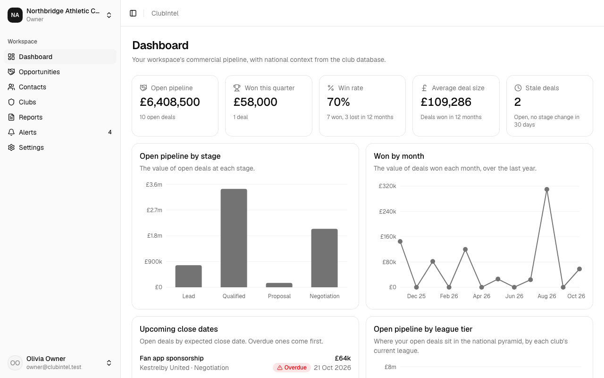
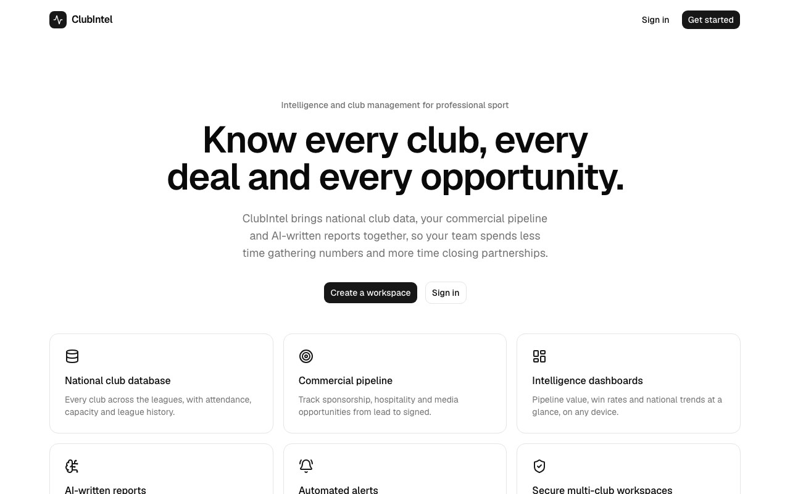
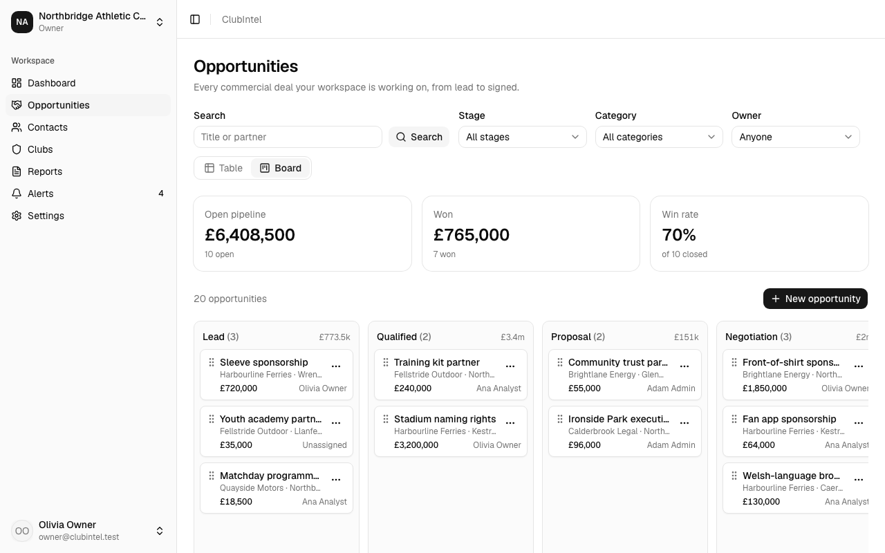
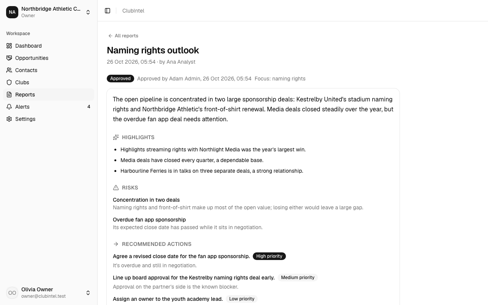
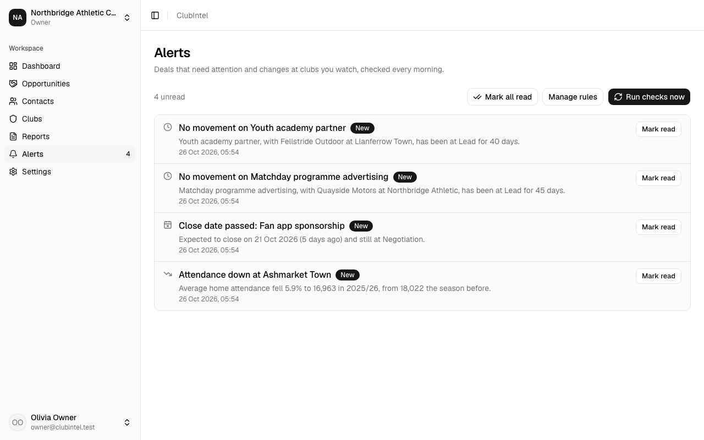
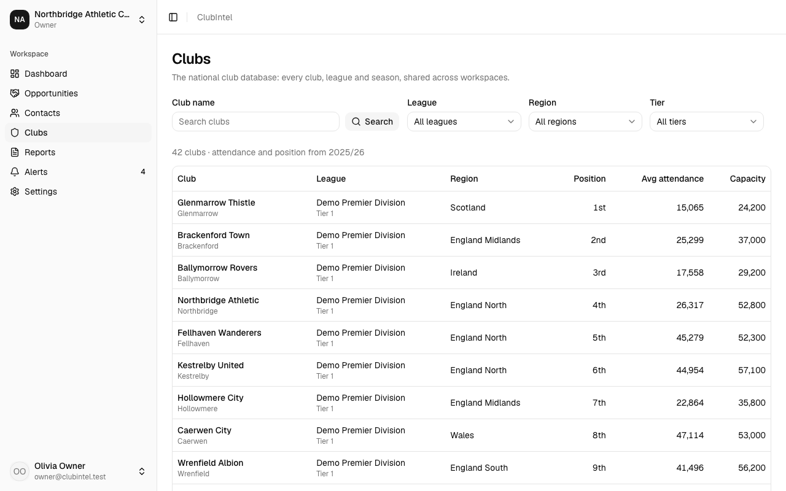
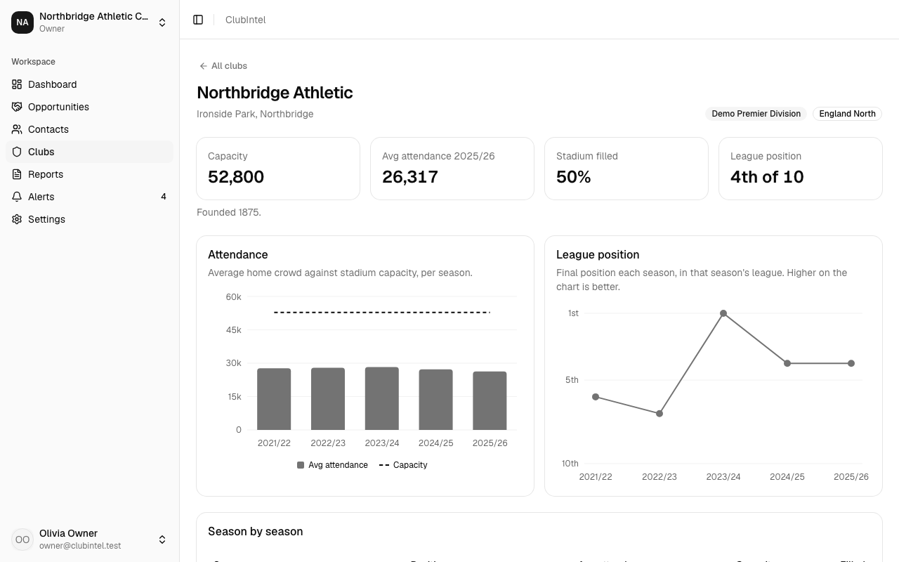
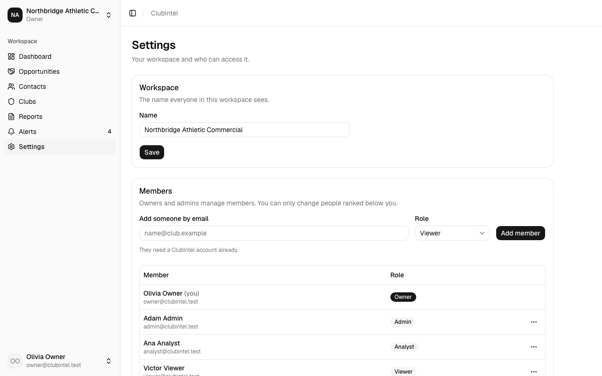
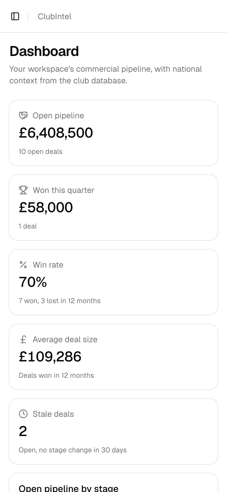
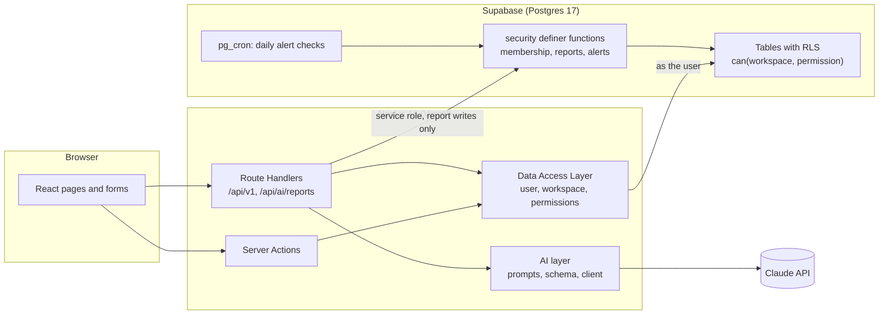

# ClubIntel

[](https://github.com/dtrinidad-iv/clubintel/actions/workflows/ci.yml)

Commercial intelligence and club management for professional sports clubs. It's a multi-tenant SaaS built with **Next.js 16, React 19, TypeScript, Supabase (Postgres + Auth + RLS + pg_cron), Tailwind CSS v4, shadcn/ui and the Claude API**.

> A demo product. All clubs, people and organizations in the seed data are fictional.



## Features

- **Multi-tenant workspaces.** Each customer organization is a workspace, and users can belong to several and switch between them. Isolation is enforced in Postgres with row level security, not just in the UI.
- **Roles and permissions.** Owner, admin, analyst and viewer map to permissions in one SQL function (`public.can()`), which policies and server code both use. You can only manage members ranked below you.
- **Auth.** Email + password sign-up, sign-in and password reset through Supabase Auth, with sessions in cookies (`@supabase/ssr`).
- **Commercial opportunities.** Each workspace tracks its sponsorship, hospitality, media and partnership deals against clubs. You get a table with filters in the URL, and a kanban board where cards move by drag and drop (mouse, touch or keyboard) or from a menu. Pipeline totals sit on top. Analysts and up create and move deals; admins and owners delete them.
- **Intelligence dashboard.** Headline numbers for the active workspace: open pipeline, won this quarter, win rate, average deal size and stale deals. Charts show the pipeline by stage and by league tier and wins by month, with national attendance against capacity by tier for context. Upcoming close dates are listed with overdue deals first. Every number is aggregated in Postgres under RLS.
- **AI intelligence reports.** Claude (Opus 5.5 by default) writes a commercial intelligence report from the workspace's own pipeline and the national club data: a summary, highlights, risks, recommended actions and clubs to watch. It streams in section by section and is saved as a draft that an admin approves or discards. Each workspace has a monthly AI budget, capped by the operator, plus hourly, per-user and platform-wide limits, all enforced in Postgres. Every report holds its worst-case cost until its real cost is known, and owners see spend in Settings. Prompts only ever contain the active workspace's data; contact details and owner names are left out.
- **Automated alerts.** Owners and admins set rules once: a deal that goes quiet, a close date that passes, or a watched club whose attendance drops. Postgres checks them every morning (pg_cron) and on demand, and alerts land in an inbox with an unread badge in the sidebar. Read state is per person, and each alert links to the exact deal or club.
- **Contacts.** The people behind each deal, at the club or on the partner side, can be linked to opportunities. The database guarantees a contact or owner always belongs to the same workspace.
- **National club database.** A shared, searchable directory of 42 fictional clubs across five leagues and four tiers, with five seasons of attendance, capacity and league position. Each club has a profile with attendance and league position charts. It's reference data every workspace reads, so it has no workspace and no write access from the app.
- **REST API.** `GET /api/v1/clubs` and `GET /api/v1/clubs/{id}` for external tools (see [API](#api)).
- **Responsive.** Every page works at 390px; the sidebar becomes a sheet on mobile.

## Screenshots

| | |
|---|---|
|  Landing |  Opportunities board |
|  An approved AI report |  Alerts inbox |
|  National club database |  Club profile |
|  Members and roles |  Dashboard on a phone |

They're made by a script from the seeded demo: `supabase db reset`, then `npm run screenshots`, which builds and starts its own server.

## Architecture



- **The workspace is the tenant, and Postgres is the boundary.** Every tenant table has RLS policies that call `public.can(workspace_id, '<permission>')`. The app queries as the signed-in user, so a bug in the app can't show another workspace's rows. References between tenant rows are composite foreign keys that include `workspace_id`. Grants are deny-by-default: each migration grants exactly the columns and functions it needs, and a catalog-wide pgTAP test pins them.
- **The active workspace is server state** (`profiles.current_workspace_id`), changed only through a membership-checked function. Client input is never proof of access.
- **AI** goes through one client interface, with a fake provider for tests and local work. Prompts contain only the active workspace's data, in a delimited block marked as data. Output is a zod-validated structure, and nothing the model writes is acted on without a person approving it. Report writes and their cost go through functions only the server's service role may run, so users can't forge a report or its cost. Budgets and limits are checked in Postgres before any call.
- **Scheduled work** runs inside Postgres with pg_cron, so there's no public cron endpoint to protect.

## Run it locally

Requirements: Node 22 (`.nvmrc`), Docker (or colima), and the [Supabase CLI](https://supabase.com/docs/guides/local-development).

```bash
npm install
npm run db:start                 # local Supabase on ports 55321-55329
cp .env.example .env.local       # then fill it in from `supabase status` (see below)
npm run dev                      # http://localhost:3020
```

| Variable | Where it comes from |
|---|---|
| `NEXT_PUBLIC_SUPABASE_URL` | `supabase status` (API URL); `http://127.0.0.1:55321` locally |
| `NEXT_PUBLIC_SUPABASE_PUBLISHABLE_KEY` | `supabase status` (Publishable key). Safe in the browser: RLS protects the data |
| `SUPABASE_SECRET_KEY` | `supabase status` (Secret key). Server-only; used just for AI report writes |
| `SITE_URL` | Public URL for email links and the AI route's origin check. Optional locally |
| `AI_PROVIDER` | `fake` (a fixed sample, no network or cost) or `anthropic`. Unset: `anthropic` if a key is set, otherwise AI is off |
| `ANTHROPIC_API_KEY` | Your Claude API key, for `AI_PROVIDER=anthropic`. Server-only |
| `AI_MODEL` | Optional; defaults to `claude-opus-5-5` |

The database is created from `supabase/migrations/` and filled from `supabase/seed.sql` (accounts and workspaces) and `supabase/seeds/*.sql`. `npm run db:reset` rebuilds the **local** database from scratch.

- **`clubs.sql`** is generated: change `scripts/generate-clubs.mjs` and run `node scripts/generate-clubs.mjs`. The script is deterministic, so the same clubs and ids come out every time.
- **`demo-pipeline.sql`** adds demo contacts and opportunities to both workspaces. It includes a year of won and lost deals dated relative to the reset, so the dashboard looks current after each `supabase db reset`.
- **`demo-reports.sql`** adds two reports to Northbridge, one approved and one draft.
- **`demo-rules.sql`** adds three alert rules and runs them once. It's named to sort last, because seeds load alphabetically.

The demo seeds are hand-written. They act as the demo users, so their rows go through the same triggers, RLS and functions as the app's.

### Demo accounts

Every demo account's password is `demo1234`.

| Email | Role |
|---|---|
| `owner@clubintel.test` | Owner of *Northbridge Athletic Commercial*, admin of *Demo Sports Agency* |
| `admin@clubintel.test` | Admin of *Northbridge Athletic Commercial* |
| `analyst@clubintel.test` | Analyst of *Northbridge Athletic Commercial* |
| `viewer@clubintel.test` | Viewer of *Northbridge Athletic Commercial* |
| `agency@clubintel.test` | Owner of *Demo Sports Agency* |

Emails sent locally (password reset, confirmation) appear in Mailpit at http://127.0.0.1:55324.

## Checks and CI

| Command | What it runs |
|---|---|
| `npm run lint` | ESLint |
| `npm run typecheck` | TypeScript |
| `npm test` | Vitest unit tests, including the AI route and the Claude client against recorded responses (no network) |
| `npm run test:db` | pgTAP tests in `supabase/tests/`: RLS isolation between workspaces, the permission matrix, grants, budgets, alerts |
| `npm run build` | Production build |
| `npm run test:e2e` | Playwright end-to-end tests (desktop + mobile) against the production build, with the fake AI provider |
| `npm run test:hooks` | Tests for the Claude Code hooks |
| `.claude/skills/verify/verify.sh [all]` | All of the above |

[CI](.github/workflows/ci.yml) runs every one of them on each push to `main` and each pull request, against a local Supabase stack in the runner. It needs no repository secrets.

## Deploy

Supabase cloud for the database, Vercel for the app: see [`docs/deploy.md`](docs/deploy.md). It covers the project settings the migrations rely on (Postgres 17, tables not auto-exposed), loading the club data, the environment variables, AI limits and a post-deploy checklist.

## API

Both endpoints need a signed-in session (the Supabase auth cookie) and answer `401` without one. They return JSON.

| Endpoint | Returns |
|---|---|
| `GET /api/v1/clubs` | `{ data: Club[], meta: { page, pageSize, total, totalPages } }`, 20 clubs a page, ordered by tier and league position |
| `GET /api/v1/clubs/{id}` | `{ data: Club }` with `league` and every season in `seasons`, or `404` |

The list's query parameters are all optional:
- `q`: part of the club name;
- `league`: a league id such as `league-one`;
- `region`: `england-north`, `england-midlands`, `england-south`, `scotland`, `wales`, `northern-ireland` or `ireland`;
- `tier`: 1–4;
- `page`.

Invalid values are ignored rather than rejected. Seasons are numbered by their starting year: `2025` is 2025/26.

## Project layout

```
src/proxy.ts                 refreshes the session cookie; optimistic redirects only
src/lib/dal.ts               Data Access Layer: current user, workspace and permissions
src/lib/supabase/            user client, service client (AI writes only), generated types
src/lib/ai/                  AI layer: client, prompts, schema, pricing, report route logic
src/lib/*-actions.ts         Server Actions, one file per feature
src/app/api/                 REST endpoints and the AI report stream
src/app/(auth)/              sign in, sign up, password reset
src/app/(app)/               the signed-in app (sidebar layout)
supabase/migrations/         schema, functions, RLS policies, grants and cron jobs
supabase/seeds/              generated club data and hand-written demo data
supabase/tests/database/     pgTAP tests
scripts/                     data generators
e2e/                         Playwright tests and the screenshot script
docs/plans/                  one plan file per feature
```

## How this was built with Claude Code

Every feature was planned, built, reviewed and shipped with [Claude Code](https://claude.com/claude-code), using rules and tooling checked into this repo:

1. **Plan.** [`/plan-task`](.claude/skills/plan-task) writes `docs/plans/NN-*.md` with the tables, policies, pages and tests, and stops for approval. Real decisions (a dependency, an architecture fork) are asked, not assumed. See [`docs/plans/`](docs/plans/README.md) for every plan, its decisions, review notes and follow-ups.
2. **Build** to the conventions in [`CLAUDE.md`](CLAUDE.md), with recipes as skills:
   - [`/new-migration`](.claude/skills/new-migration): migration safety rules;
   - [`/tenant-feature`](.claude/skills/tenant-feature): the steps for a workspace-owned feature;
   - the `claude-api` skill for the AI layer.
3. **Guard.** [Hooks](.claude/hooks) run on Claude's own actions:
   - **blocked:** force-pushes, remote database resets, edits to committed migrations, secrets written into files, and server secrets in client code;
   - **asked first:** before any push;
   - **type-checked:** every TypeScript edit.

   The hooks are tested in `tests/hooks.test.mjs`.
4. **Review.** Four read-only [subagents](.claude/agents) review every change: `code-reviewer`, `security-auditor`, `rls-reviewer` (with SQL against the local database) and `ui-reviewer` (a real browser at 390, 768 and 1280px). Their findings and fixes are recorded in each plan. Several were real bugs, such as AI usage recorded as $0 and a test that proved nothing.
5. **Verify and ship.** [`/verify`](.claude/skills/verify) runs every check. [`/ship-plan`](.claude/skills/ship-plan) commits by area (db, web, tests, tooling), marks the plan done with its commit hashes, and pushes. CI runs the same checks on GitHub.
